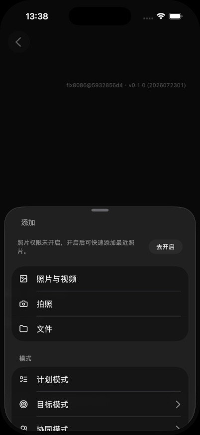
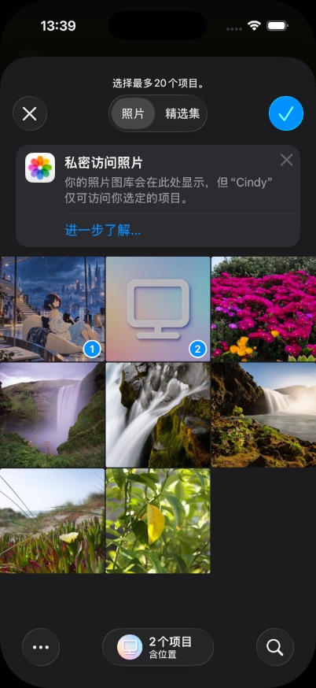
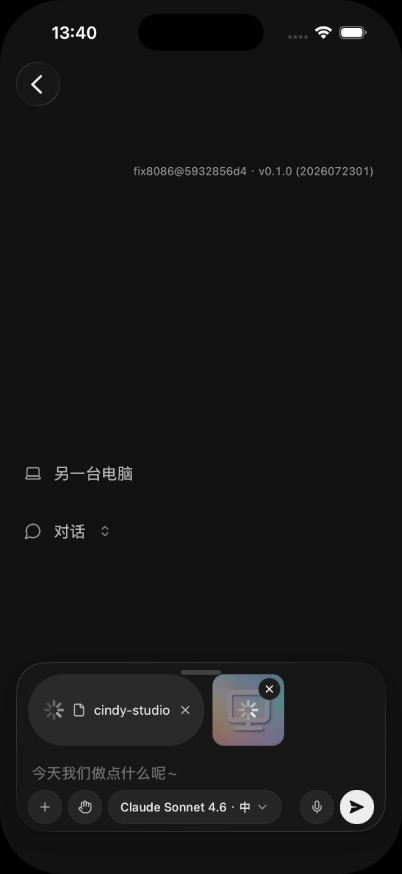
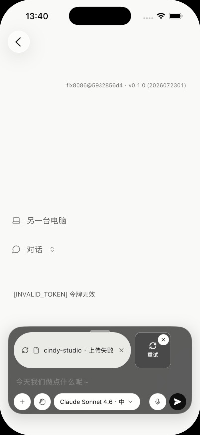
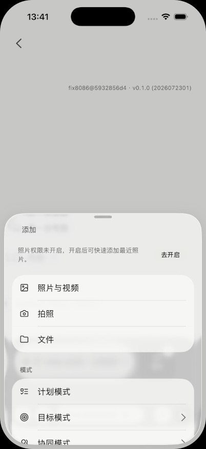
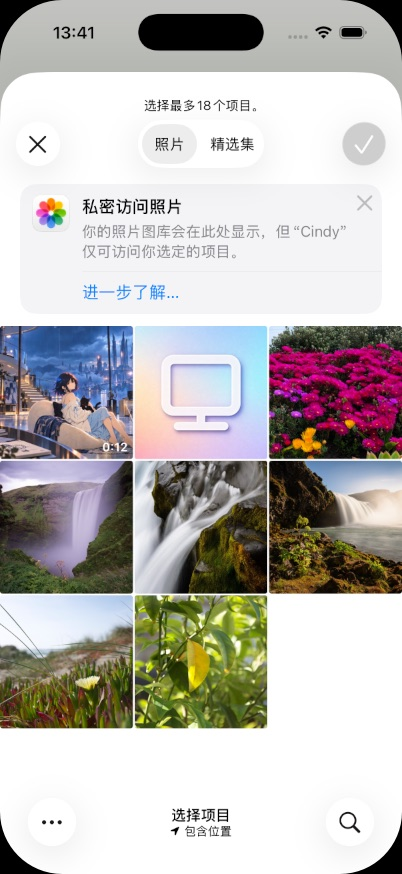
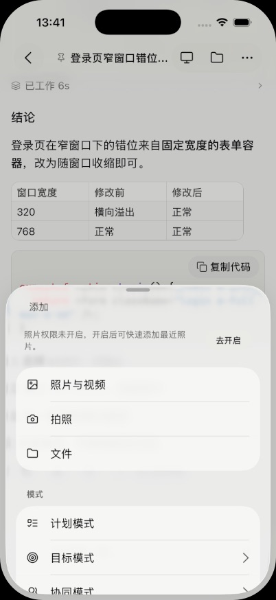
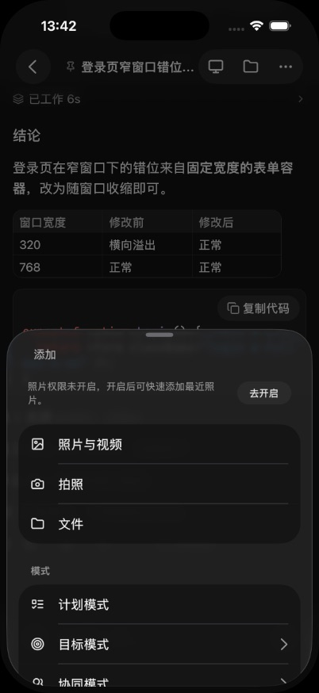
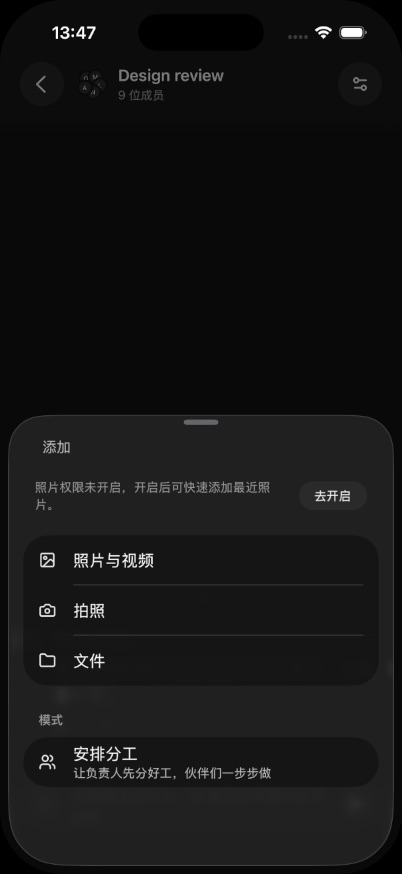
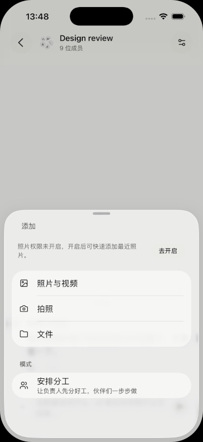

# PR #8086 原生模拟器证据

2026-11-02，iPhone 17 Pro / iOS 26.5，402 × 874pt，Global __DEV__ mock，真实生产组件与系统 PHPicker，公开图片/视频样本。

原生模块在 5932856d42 完整编译成功、整包安装校验 matchesLocal=true；a8d807569a 仅给已有 dev-only 群夹具添加 supportsAttachments=true，原生模块和其他生产组件字节不变。复验原生指纹一致、Metro 来源匹配新 head。截图各自来源见 manifest。

已验证：新建任务、已有普通任务、群聊的照片与视频入口 Light/Dark；同一次系统选择一张图和一个视频，返回后分别进入图片/文件附件队列；拒绝广泛照片权限后 PHPicker 仍能使用；取消返回。

上传返回 INVALID_TOKEN，保留失败/重试/移除，未发送。物理真机、iCloud、Live Photo、Android 和真实传输仍未验收。模拟器与 mock 不代表真实服务器端到端成功。

### 新建任务统一入口，未授予相册广泛读取权限

### 系统 PHPicker 同批选择一张公开图片与一个视频

### 选择后返回新建任务，检查视频文件与图片分别保留

### 混选进入既有上传队列，mock 令牌 INVALID_TOKEN，保留失败与重试入口，未发送

### 新建任务统一照片与视频入口，Light

### 未授予全相册权限时仍打开系统混选器，Light

### 已有普通任务统一入口，Light

### 已有普通任务统一入口，Dark

### 开发夹具能力补齐后的群聊统一照片与视频入口，Dark

### 开发夹具能力补齐后的群聊统一照片与视频入口，Light

### 群聊入口实际打开包含视频的系统相册，取消返回，未发送

