# PR #8088：iPhone 模拟器浅色／深色验证

- 验证日期：2026-10-30；证据上传日期：2026-11-02。本次上传既有证据，没有宣称重新运行验证。
- 环境：iPhone 17 Pro 模拟器、iOS 26.5、402×874pt、Global、简体中文、原生开发包 `com.xd.cindy`，版本 0.1.0 (2026072301)。
- 使用 `--mock` 示例数据驱动正式 BotGroupWorkArea／BotGroupSpeakerRow，点击与滑动走模拟器真实触摸通道，没有替换 UI 组件或注入点击事件。
- 集成源码身份：`feat/mobile-direct-group-attachments@55cf935b5+6adbab3b36`，Metro 8081；原生指纹与源码匹配，whoami 为 healthy，设备实际显示新 bundle 标签。whoami 的 pageVerified=false 不被伪装成页面已验证；页面证据来自本目录的截图与实际触摸观察。
- 两份被测组件逐字节匹配 PR 最初提交 `86837dffd61b5503f2ee621b29d50b662c6d4eac`；上传时核对最新 PR 提交 `876bc498c9e820e35dd1a14c4cfe799de6f01c6f`，两份组件内容仍相同。集成工作区含其他修改，这些图片不代表最新 PR 全部依赖已在独立 checkout 重新验收。
- 已观察：44pt 收起入口；单伙伴详情按内容高度；多伙伴有界滚动；收起时批准／提问自动显露；模拟允许一次和提交回答后恢复收起；两种主题及键盘弹出状态可读、可操作。
- 较长交互卡的操作区需要在 220pt 详情区域内滚动到达，已实际操作。既有开发依赖警告曾显示，截图前通过关闭按钮收起提示，未裁剪错误或改写截图。
- 未覆盖：实体 iPhone、Android、其他屏宽、真实账号、真实 Agent 与断网／重连执行链路、最新完整依赖回归、与 #7806 整合后的验收。
- 图片全部来自虚构群聊和示例数据；不包含真实群消息或账号身份。公开 identity/manifest 已移除本机绝对路径和无关设备信息。
- 仅发布到作者 fork 的截图分支，不改变代码 PR 的提交、文件或状态。CI 和评审状态以 GitHub 当前记录为准，本证据不表示 CI 全绿。

## 20 张截图

### 1. 浅色：6 位伙伴默认合并为 44pt 一行

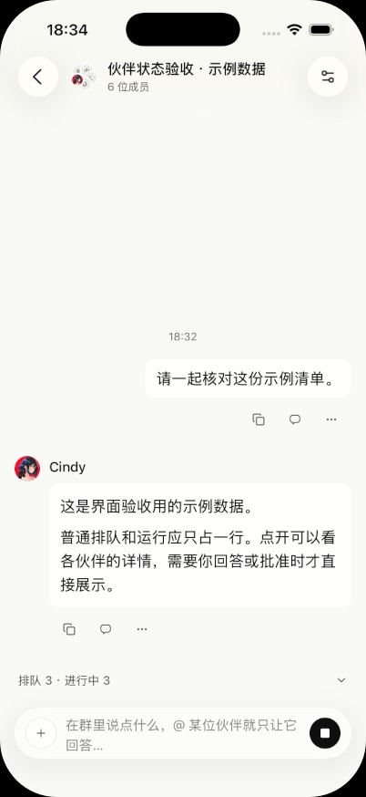

### 2. 浅色：展开多伙伴详情，区域最多 220pt

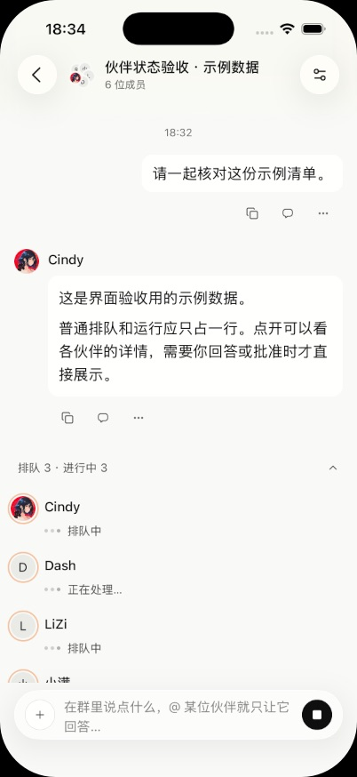

### 3. 浅色：详情内部滚动与长伙伴名

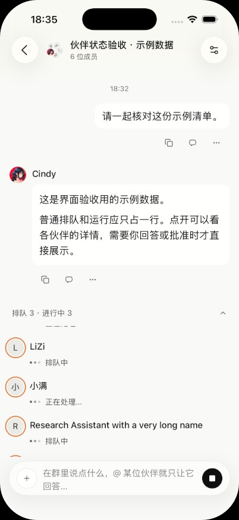

### 4. 浅色：单伙伴排队提示

### 5. 浅色：自动显露的批准卡可滚动到操作区

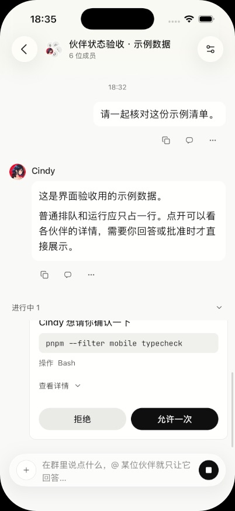

### 6. 浅色：点击模拟允许一次后恢复收起

### 7. 浅色：自动显露的提问卡与操作区

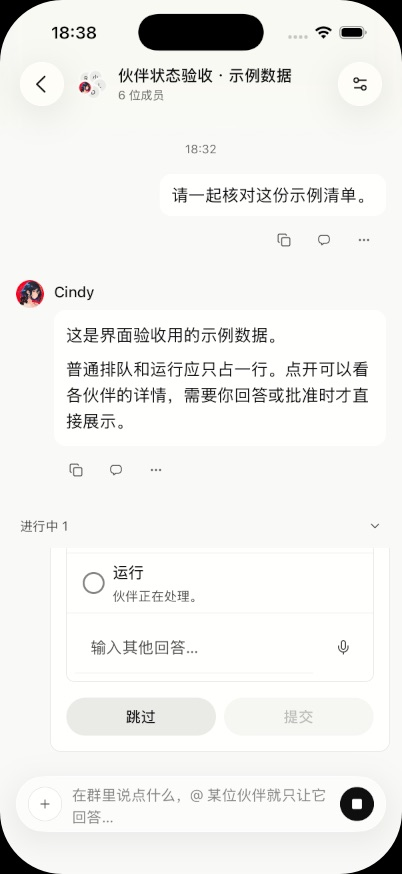

### 8. 浅色：键盘弹出，提示仍收起为一行

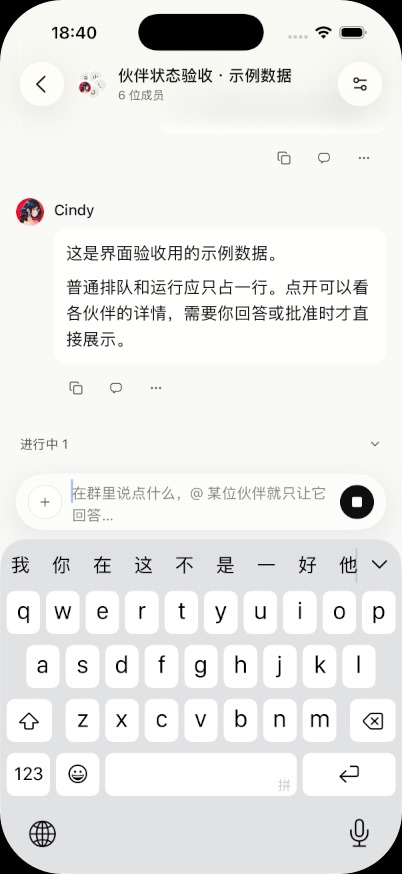

### 9. 浅色：键盘弹出时展开伙伴详情

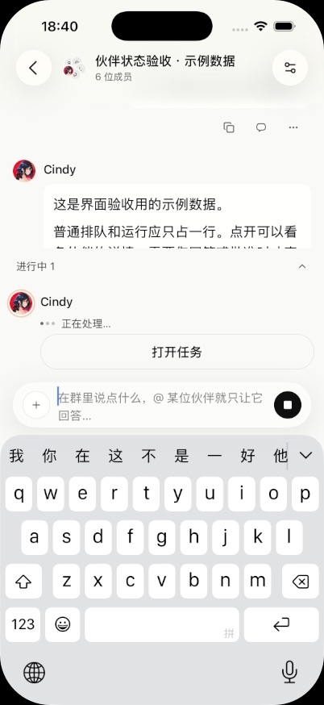

### 10. 深色：6 位伙伴默认合并为一行

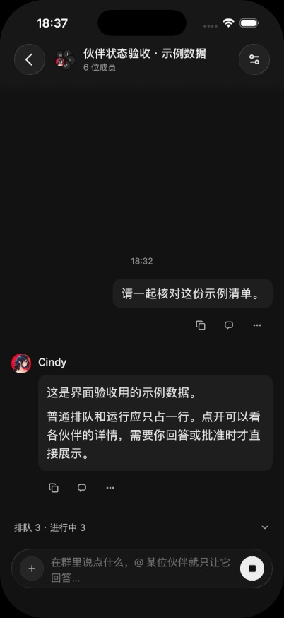

### 11. 深色：展开多伙伴详情

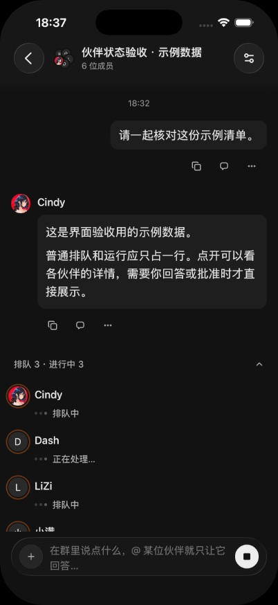

### 12. 深色：单伙伴排队提示

### 13. 深色：单伙伴展开按内容增高，未填满 220pt

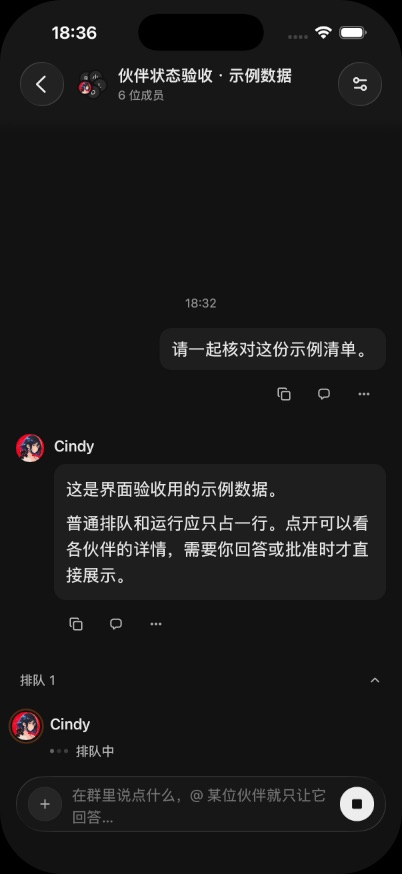

### 14. 深色：批准卡与允许一次按钮

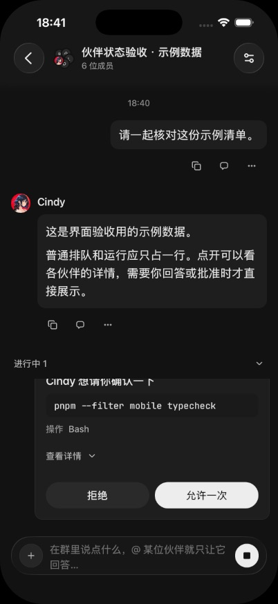

### 15. 深色：模拟批准后恢复收起

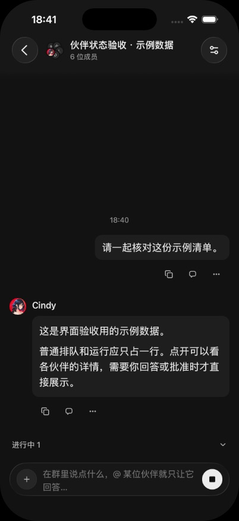

### 16. 深色：提问卡选择回答后提交按钮可用

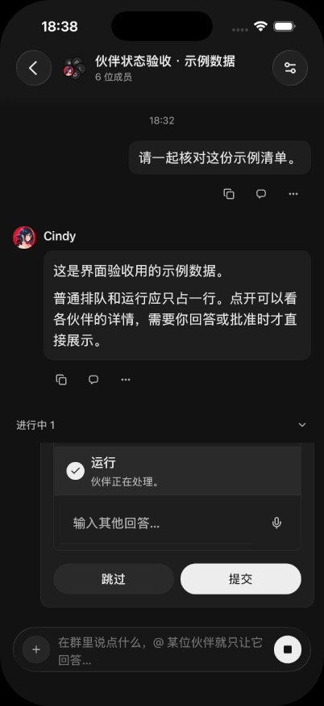

### 17. 深色：提交模拟回答后恢复收起

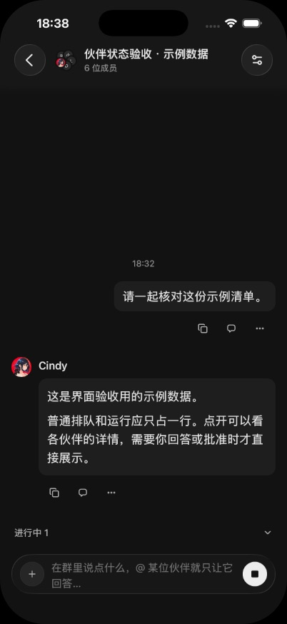

### 18. 深色：键盘弹出时的收起状态

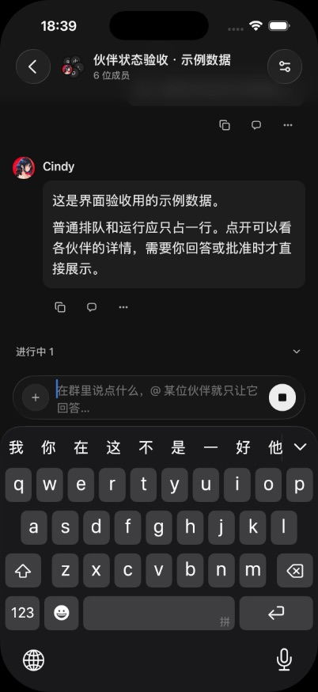

### 19. 深色：键盘弹出时的展开状态

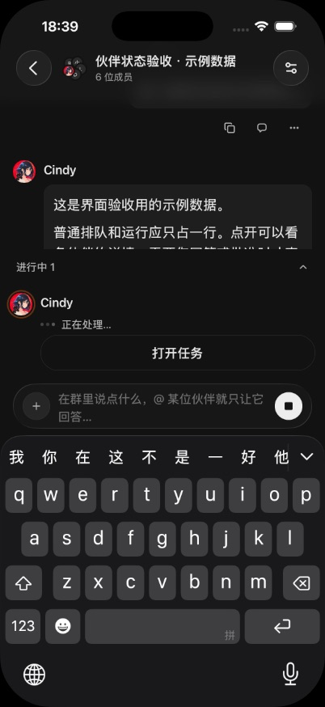

### 20. 开发构建标签与源码身份

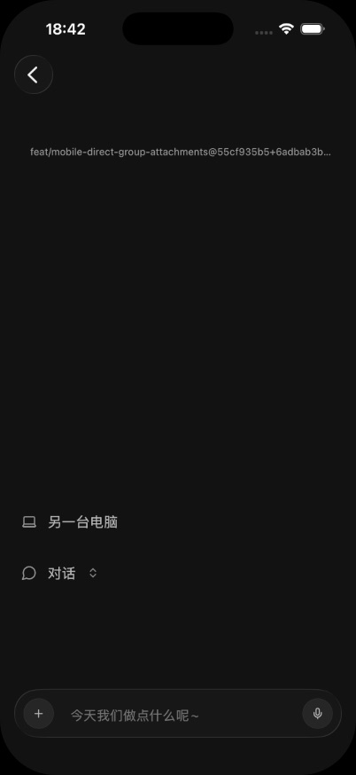
